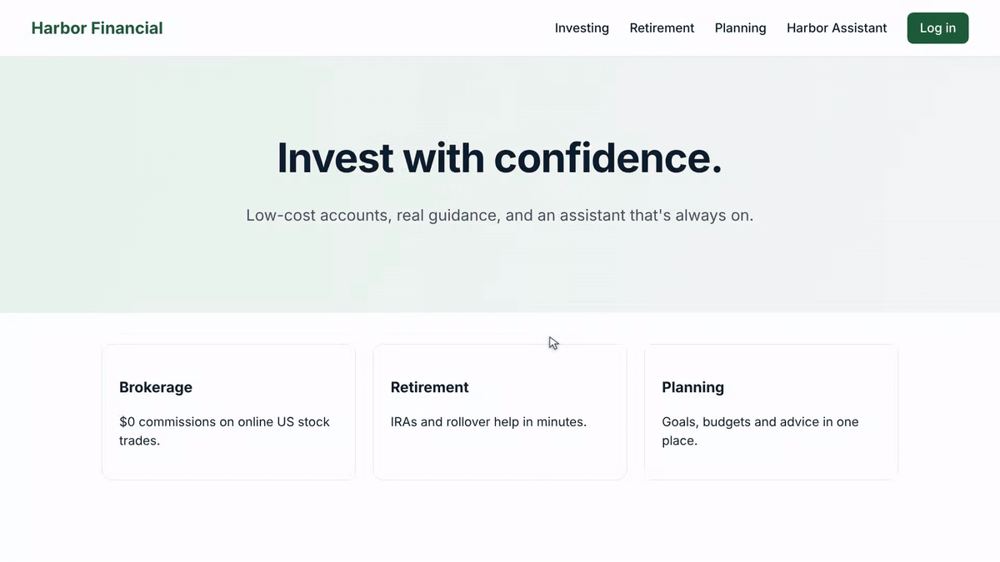

# Stand-in

**Turn a website walkthrough into a video you can share, in one take.** Open a site, press
Shift twice, show what you want to show, and press Shift twice again. A few seconds later you have a
finished MP4, with no editing, exporting or converting.



*An example video made with Stand-in, showing a chat assistant on a made-up website (sped up 1.5×). The
captions and highlights were added afterwards; see [Make it again, or polish it](#make-it-again-or-polish-it).*

## What you get

Every time you stop recording, Stand-in gives you:

- **A video that's ready to share.** A standard MP4 that plays in QuickTime (including on Intel Macs),
  Windows, PowerPoint, Teams, Slack and video editors. It's named after the site and the time, such as
  `wikipedia.org-2026-11-22-14-05.mp4`, and VS Code offers to open it.
- **Without the dead air.** Pauses where nothing on screen changes are shortened to at most 3 seconds,
  and the wait before your first action and after your last is trimmed. Anything that moves is kept:
  the pointer, pages loading, an answer appearing.
- **Even if something goes wrong.** The video is saved while you record. If you close the tab or Chrome,
  press Ctrl+C, or Chrome crashes before you stop, you still get everything up to that moment.
- **A record of your steps, so you can make the video again.** Stand-in also saves a list of the
  clicks and typing in your demo, called a replay plan, in the `demos` folder. Later, it can repeat
  those steps and record a fresh video, for example after the website changes, or with captions,
  highlights and a smooth cursor added. See [Make it again, or polish it](#make-it-again-or-polish-it).

## How it works

1. In VS Code, choose **Stand-in: Record Website** and enter an address, such as `wikipedia.org`.
2. Chrome opens the site. Sign in or get the page ready, then press **Shift twice**, quickly. The
   tab's title shows a red dot and a timer (● 0:12) while you record.
3. Do your demo and press **Shift twice** again. Chrome closes, and VS Code says
   **Your video is ready**. Choose **Open Video**.

That's all there is to it. Shift on its own doesn't type anything, so it never gets in the way of your
demo, and typing capital letters won't set it off. If pressing Shift twice does nothing, click the
page and try again, or click in the Stand-in terminal in VS Code and press **Enter** instead, once to
start and once to stop.

## Set up once

You need:

- **VS Code 1.109 or newer.** [Download VS Code](https://code.visualstudio.com/).
- **Google Chrome 153 or newer.** [Download Chrome](https://www.google.com/chrome/). Beta, Dev, Canary
  and Chrome for Testing also work. Stand-in opens its own Chrome window.
- **The Stand-in extension**, a `.vsix` file from a [project release](https://github.com/beekmarks/stand-in/releases)
  or your project maintainer.

To install it, open the Command Palette (**Cmd+Shift+P** on Mac, **Ctrl+Shift+P** on Windows and
Linux), choose **Extensions: Install from VSIX**, and select the file.

There's nothing else to install. The extension uses the Node.js built into VS Code. With a VS Code from
before early 2026, Stand-in says so and links to [Node.js](https://nodejs.org/en/download): install
version 22 or newer, then fully quit and reopen VS Code. If Chrome is missing or too old, Stand-in's
message has a button to get it.

## What to expect

**When you start.** The address box remembers your last site. Stand-in doesn't ask where to save:
videos go into the folder open in VS Code or, if none is, into **Movies/Stand-in** in your home folder
(**Videos/Stand-in** on Windows and Linux). Stand-in keeps the browser session between recordings, so
once you sign in, the next recording starts signed in too.

**While you record.** The tab's title shows ● and the time. Everything happens in the one tab Stand-in
opened: links and buttons that would open a new tab open right there instead, so they're in the video.
The address bar, browser dialogs and sound aren't recorded, and neither are pop-up windows a site needs
to keep separate, such as a sign-in window. Pause whenever you like, because long pauses are shortened.

**When you stop.** Chrome closes and the video is ready a few seconds later, roughly a quarter of the
recording's length on a typical laptop. The terminal shows its length, such as
`(0:48; pauses shortened from 1:12)`, and VS Code offers **Open Video**, **Show in Folder** and
**Open Replay Plan**.

**If something goes wrong.** You get one plain sentence saying what happened and what to do, not a
technical error. A recording that ends early is still saved. A recording stopped in its first few
seconds may be too short to save. See [Troubleshooting](docs/recipes.md) for more.

## Before you share

Stand-in records everything visible in the tab, including account details, and doesn't blur anything.
Watch the video first, and use a video editor to remove anything you don't want shown.

The replay plan in **demos** can contain page addresses and text you typed (password fields are left
out). The hidden **.sessions** folder holds your browser session, including sign-in cookies. Keep both
private, and don't commit them to version control without checking.

## Make it again, or polish it

Replay visits the site again, does what you did, and records a **new** video. It doesn't change your
first one. Use it when the site has changed, or to add captions and highlights by editing the plan (see
the [plan reference](docs/plan-format.md)).

1. Choose **Open Replay Plan** in the "Your video is ready" message, or open the `.json` file in
   **demos**.
2. Choose **Stand-in: Replay Plan**. The plan that's open in the editor replays straight away.
3. Each step is listed in the terminal as it runs. VS Code says **Your video is ready** when it's done,
   for example `wikipedia.org-2026-11-22-14-05-replay.mp4`.

What to expect from replay:

- **It starts calmly and moves briskly.** The first page shows for three seconds before anything
  happens. After that, wherever you paused, the replay pauses for one second. Waits for pages, and for
  chat assistants to finish answering, last as long as they need.
- **It shows what you pointed at.** Resting the pointer on something that opens a menu or shows a tip,
  without clicking, is a step too, and the replay holds it there for a second.
- **It copes with sites that change a little.** Pop-ups and cookie notices you closed are skipped if
  they don't appear again. Counts and other numbers in link names can change.
- **It tells you exactly what to fix.** If a step can't be done, the replay stops and names the step
  and the reason, such as "Couldn't find the link “Pricing” on the page within 10 seconds." The video
  up to that point is saved with `-incomplete` in its name. Edit that step and replay again.
- **It asks before acting as you, when needed.** Replays use your saved session, so they can make real
  changes on signed-in sites. A plan you recorded replays without asking. One that is new to Stand-in or
  has been edited is shown to you once: type **y** in the terminal only if you approve its actions.

### The five things people change most

Open the plan (**Open Replay Plan**), change it, and replay. Settings go at the top of the plan, next to
`"url"`; captions go in its `"steps"`.

1. **How long the first page shows.** `"leadInMs": 3000` is three seconds before the first action.
   `"tailMs": 1500` is how long the video runs on after the last one.
2. **The time between actions.** `"pauseAfter": 1000` pauses a second after every step (each step can
   also have its own `"pauseAfter"`). `"pace": "relaxed"` or `"brisk"` slows down or speeds up the
   whole replay, cursor included. To linger at one point, add a step such as
   `{"action": "wait", "ms": 2000}`.
3. **Captions.** Add `{"action": "caption", "text": "Search for a fund"}` before the step it describes;
   it stays on screen until the next caption, or `{"action": "caption", "text": null}` to clear it.
   `"captionSize": 40` makes captions bigger. To draw attention to something, add
   `{"action": "highlight", "target": {"text": "Expense ratio"}, "ms": 1500}`.
4. **The cursor and clicks.** `"cursorColor": "#111111"` and `"cursorSize": 36` change the cursor.
   `"accent": "#0b6bcb"` changes the color of the ring shown on each click and of highlights, and
   `"clickEffect": false` turns the ring off. `"cursor": false` hides the cursor altogether.
5. **The size of the video.** `"viewport": {"width": 1920, "height": 1080}` sets it, and `"zoom": 1.25`
   enlarges the page so small text is readable.

For example:

```json
{
  "url": "https://www.example.com/",
  "leadInMs": 2000,
  "pauseAfter": 800,
  "accent": "#0b6bcb",
  "steps": [
    {"action": "caption", "text": "Find the pricing page"},
    {"action": "click", "target": {"role": "link", "name": "Pricing"}}
  ]
}
```

Everything else is in the [plan reference](docs/plan-format.md).

**Demoing a chat assistant?** Ask your question, then wait for the whole answer before doing anything
else. Replay then waits for the answer, however long it takes. See
[Waiting for chat answers](docs/plan-format.md#waiting-for-chat-answers).

To try replay without recording anything, download this repository (**Code > Download ZIP**), choose
**Stand-in: Replay Plan**, and select `demos/sample/assistant-tour.json`. It runs on a fictional site
included in the repository.

## Sites that push back

Many sites protect themselves from automated browsers, and Stand-in's Chrome is one: Stand-in controls
it, the same way test tools do. Most sites don't mind, but some do, and no tool should get around that.
What you may see:

- **A security check.** "Just a moment…", "Verify you are human", "Press & Hold" or a slider puzzle,
  either instead of the page or partway through. While recording, complete it yourself if it lets you;
  the check is then part of the video, so you may want to record again later. A replay can't pass it,
  so it stops at the step after.
- **A different page on the next visit.** Replay reuses your browser session, so the site sees a
  returning visitor. Some sites then show another home page, remember a language or region you chose,
  or skip a welcome offer, and a step that depended on them fails.
- **Content that changes every visit.** Headlines, reviews, recommendations and ads rotate. A plan that
  clicks one of them breaks when it's gone; click something lasting, such as a menu or a section link.
- **A sign-in page instead.** Some links, such as to LinkedIn or to an account area, lead to a sign-in
  page when you aren't signed in to that site.

**Try a site by hand first.** Before asking an assistant to make a demo of a site, record a short one
yourself. A minute of clicking around shows whether the site lets Stand-in in, whether it asks for
checks or sign-in, and what's lasting enough to show. Then you know that a failed demo of that site
is worth fixing, and the assistant can work from what you saw. If you're recording for colleagues,
replay your own plan once too, to make sure it works the second time.

## Other ways to use Stand-in

**Ask an assistant.** With GitHub Copilot in VS Code, you can describe the demo instead of performing it:

> Use Stand-in to open https://www.wikipedia.org, search for space exploration, and show the result.

Try the site by hand first (see [Sites that push back](#sites-that-push-back)). The extension
includes this skill. It can also be [installed on its own](docs/company-pilot-guide.md#option-2-use-the-copilot-skill-without-the-extension),
which needs Node.js 22 or newer. The assistant won't sign in for you.

**Command line.** From a source checkout, with Node.js 22+ and Chrome 153+:

```sh
npm ci --prefix tools/recorder
node tools/recorder/record.mjs wikipedia.org
node tools/recorder/record.mjs replay demos/wikipedia.org-2026-11-22-14-05.json
```

It works the same way: Shift twice or Enter to start and stop, Ctrl+C to stop and save. Files go
into `recordings/` and `demos/` in the current folder. `--rehearse` tries a replay without recording,
`--av1` keeps Chrome's original AV1 video instead of converting it, and `--debug` shows technical
details.

## Need help?

[Troubleshooting](docs/recipes.md) covers starting and stopping, finding videos, playback, replay failures and
sensitive information. The [company pilot guide](docs/company-pilot-guide.md) is a short version to
share with colleagues. The [plan reference](docs/plan-format.md) covers editing replay plans.

## Related projects

Stand-in builds on Chrome's native tab recorder, first packaged by Paul Irish's
[chrome-capture](https://github.com/paulirish/chrome-capture), with browser control from Playwright and
video conversion by [mediabunny](https://mediabunny.dev). If you only ever need one take and never
re-record, a screen recorder such as Loom may be simpler. For scripted videos, see
[webreel](https://webreel.dev/) and Playwright's screencast API. For turning clicks into steps, see
[Chrome DevTools Recorder](https://developer.chrome.com/docs/devtools/recorder), Playwright `codegen`,
[RunThru](https://github.com/marktolson/runthru) and [humanjs](https://github.com/totigm/humanjs).

## For developers

Install Node.js 22+, run `npm install`, then:

- `npm test` runs the extension and packaging tests; `npm test --prefix tools/recorder` runs the
  recorder's.
- `npm run site-check` makes real demo videos of Wikipedia, GitHub, MDN, Hacker News, weather.gov,
  DuckDuckGo and BBC the way a person would, replays each plan, and reports how long each video took
  in `.runs/site-check-<time>/report.md`. Name sites to check only those
  (`npm run site-check -- github mdn`), and add `--headless` without a display. Sites change, so treat
  a failure as a lead.
- `npm run site-sweep` tries Stand-in on about 100 popular websites listed in
  `scripts/sweep-sites.json`, with no site-specific steps. On each one it behaves like a first-time
  visitor: it closes a cookie notice, opens a menu and clicks a link in it, follows a link, searches for
  "help", scrolls, and follows a link that opens a new tab. Then it checks that a playable video was
  made, everything stayed in one tab, the plan has a step for each action, the plan isn't fragile (no
  ids that change on every visit, links saved with where they go, no needed click made optional), and the
  plan replays to the same page. The report, in `.runs/site-sweep-<time>/report.md`, groups problems by kind with a
  screenshot of each site. Choose kinds of site or single sites (`npm run site-sweep -- news github.com`),
  run a second set of 100 sites with `--extended` (listed in `scripts/sweep-sites-extended.json`),
  or re-check the plans an earlier sweep saved without visiting anything
  (`npm run site-sweep -- --check-plans .runs/site-sweep-<time>`).
  It takes one to two minutes a site; sites that block automated browsers are listed separately.
- `npm run package` builds the `.vsix`; `npm run package:skill` builds the standalone skill ZIP in
  `dist/`. Rebuild the ZIP when the skill, recorder or plan reference changes.
